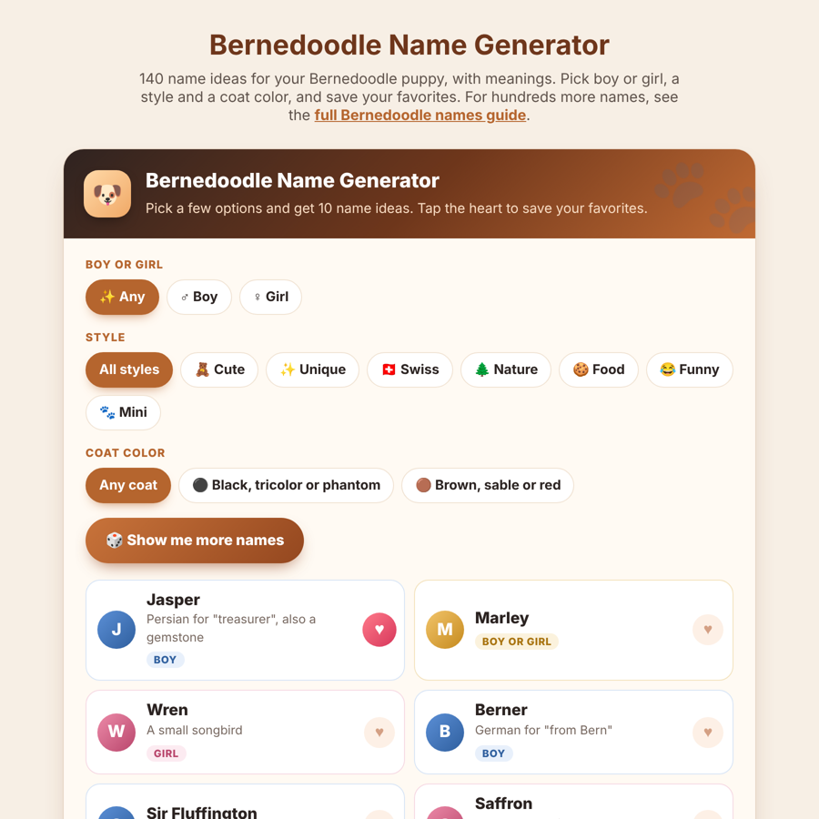

# Bernedoodle Name Generator

A free, lightweight name generator for Bernedoodle puppies, with 140 boy, girl and gender-neutral names and their meanings. Filter by style (cute, unique, Swiss, nature, food, funny, Mini) and coat color, and save favorites to a shortlist.

Made by **[I Love Bernedoodle](https://ilovebernedoodle.com/)**, a site about Bernedoodle size, care, food and training. For hundreds more ideas, see the full **[Bernedoodle names guide](https://ilovebernedoodle.com/bernedoodle-names/)**.

**[Try the live demo](https://YOUR-USERNAME.github.io/bernedoodle-name-generator/)**

## Features

- 140 names, many with meanings (Swiss and Bernese names included)
- Filters for boy or girl, 7 name styles and 2 coat-color groups
- Shortlist saved in the browser, with a one-click copy button
- Works on phones and desktops
- One file, about 15 KB, no libraries, no tracking, no external requests

## Add it to your own website

1. Open [`embed.html`](embed.html) and copy all of the code.
2. Paste it where you want the tool:
   - **WordPress:** a **Custom HTML** block (you need an Administrator account).
   - **Other sites:** anywhere in your page's HTML.
3. Please keep the small "Bernedoodle name generator by I Love Bernedoodle" credit link at the bottom.

## Files

| File | What it is |
| --- | --- |
| `index.html` | The demo page shown on GitHub Pages |
| `embed.html` | The tool with a credit link, for other websites |
| `wordpress-snippet.html` | The version used on ilovebernedoodle.com |
| `screenshot.png` | Preview image for this page |

## License

[MIT](LICENSE): free to use, change and share. Credit is appreciated.
